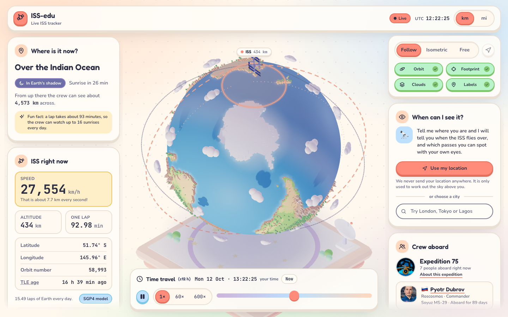
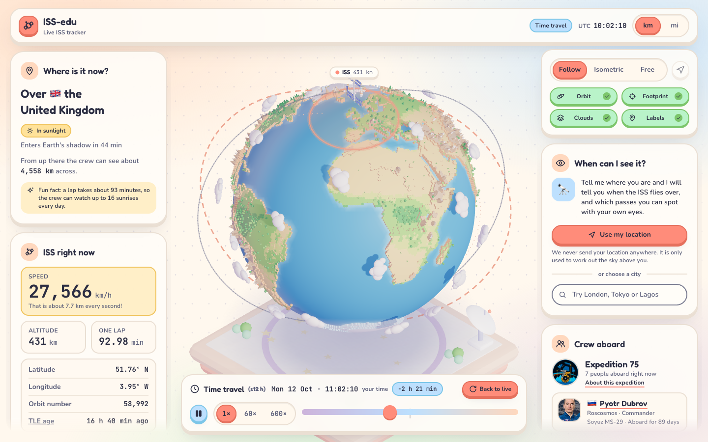
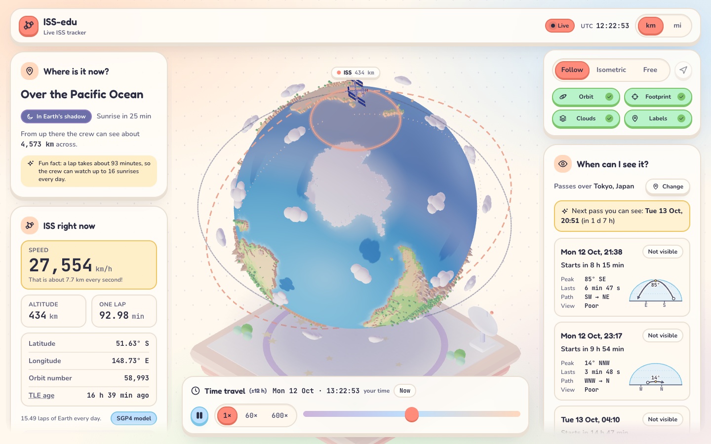
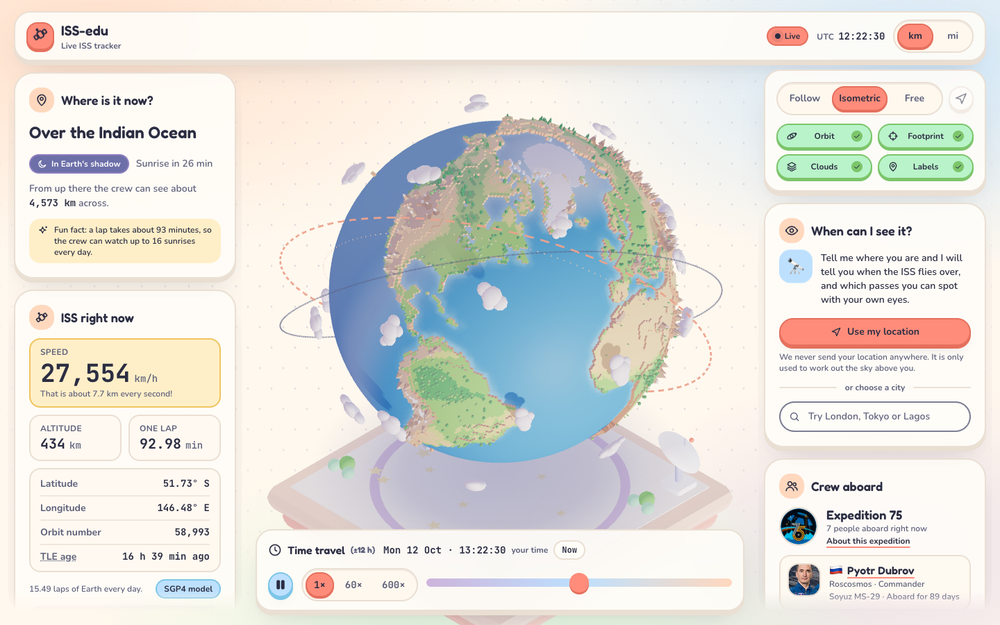
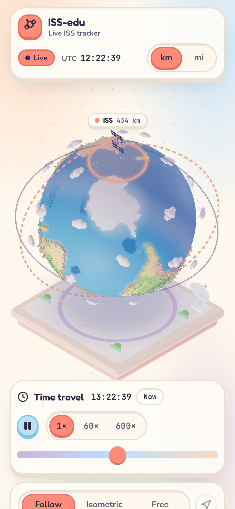
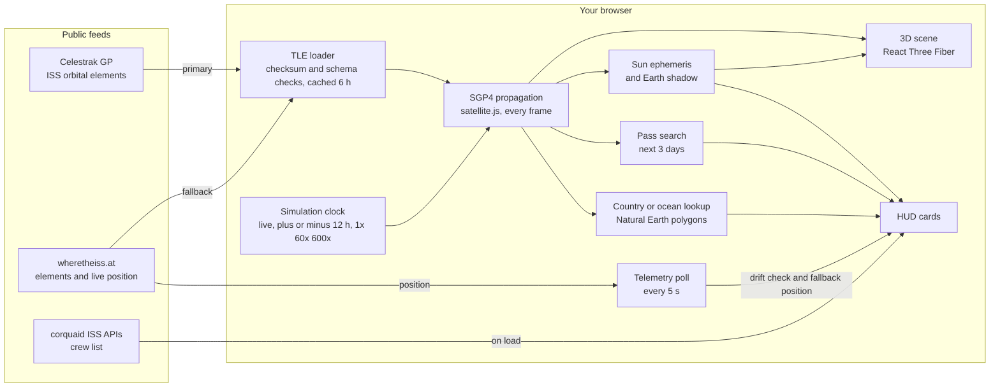

# ISS-edu

**A cute, isometric 3D tracker for the International Space Station. Real orbit maths, the real Sun, the real crew, all running in your browser.**

[](https://github.com/CodeWithBehnam/ISS-edu/actions/workflows/ci.yml)
[](https://github.com/CodeWithBehnam/ISS-edu/actions/workflows/pages.yml)
[](LICENSE)

### Live demo: <https://codewithbehnam.github.io/ISS-edu/>



ISS-edu shows where the International Space Station is right now on a pastel diorama of Earth built from hexagonal tiles in Blender. The station's position is calculated in your browser with the SGP4 orbit model from the latest public orbital elements, lit by the actual position of the Sun, and cross-checked against a live position feed every five seconds. Tell it where you are, or pick a city, and it works out when the station will fly over you and whether you will be able to see it.

It is a static, client-side app. There is no backend, no account, no API key and no tracking.

## Contents

- [Features](#features)
- [Screenshots](#screenshots)
- [Quick start](#quick-start)
- [Run with Docker or Podman](#run-with-docker-or-podman)
- [Scripts](#scripts)
- [How it works](#how-it-works)
- [The Blender models](#the-blender-models)
- [Project structure](#project-structure)
- [Testing](#testing)
- [Configuration](#configuration)
- [Deployment](#deployment)
- [Privacy and security](#privacy-and-security)
- [Known limitations](#known-limitations)
- [Data sources and credits](#data-sources-and-credits)
- [Built with Claude Code](#built-with-claude-code)
- [Contributing](#contributing)
- [Licence](#licence)

## Features

**Tracking**

- **Live 3D tracking.** The ISS is propagated with SGP4 ([satellite.js](https://github.com/shashwatak/satellite-js)) on every rendered frame, so it glides smoothly instead of jumping between feed updates. If the network drops, the app carries on from a cached orbit for up to a week.
- **Real Sun, real shadow.** The Sun's direction comes from a low-precision solar ephemeris (about 0.01 degrees from 1950 to 2050) and drives the lighting and the day and night sides of the globe. The station's solar wings turn to face the Sun, and the whole model dims when it enters Earth's shadow.
- **Where is it now?** The country (with its flag) or the ocean or sea under the station, found by testing the position against [Natural Earth](https://www.naturalearthdata.com/) country polygons.
- **Sunlight countdown.** Whether the station is in sunlight or in Earth's shadow, and how long until that changes, found to within a second.
- **Live readings.** Speed, altitude, latitude, longitude, orbit number, orbital period and the age of the orbital elements, in kilometres or miles. A "SGP4 model" or "Live feed" label says where the numbers come from, and a drift note compares the model with the live feed.

**Passes and people**

- **Pass predictions.** The next passes over your location for the following three days (up to twelve): start time and countdown, peak elevation and compass direction, duration, path across the sky and a small sky-arc diagram. A pass is flagged as visible when the station is at least 10 degrees up, in sunlight, while the Sun is more than 6 degrees below your horizon, and is rated excellent, good, fair or poor.
- **Your location, or a city.** "Use my location" asks the browser only when you press it. Or search a built-in list of 94 cities in 64 countries. Neither is ever sent anywhere.
- **Crew aboard.** The current expedition and everyone on the station, with agency, role, nationality and how long they have been aboard.

**Exploring**

- **Time travel.** Scrub up to 12 hours either way, play at 1x, 60x or 600x, pause, and jump back to live.
- **Three views.** *Follow* keeps the station facing you as the Earth turns beneath it. *Isometric* is a desk globe on its stand. *Free* lets you drag to rotate and scroll or pinch to zoom.
- **Layers.** Toggle the orbit line, the footprint (the area the crew can see), the clouds and the labels.

**Craft and care**

- **Resilient.** If WebGL is unavailable or the 3D scene fails, an SVG world map with a day and night terminator and the ground track takes over. If a model fails to load, a low-poly stand-in is used. If a feed fails, the next source is tried, then the cache.
- **Accessible.** Every control is reachable from the keyboard, the city search follows the WAI-ARIA combobox pattern, a polite live region announces the station's location at most once a minute, focus is clearly visible, text colours were checked against the WCAG AA 4.5:1 ratio, and `prefers-reduced-motion` is respected.
- **Responsive.** One column on phones, a three-column HUD around the globe from 1024 px.
- **Private by design.** See [Privacy and security](#privacy-and-security).

## Screenshots

<table>
  <tr>
    <td width="50%">
      
      <br><sub><b>Time travel.</b> Scrub back 2 h 21 min and the ISS is over the United Kingdom.</sub>
    </td>
    <td width="50%">
      
      <br><sub><b>Pass predictions</b> for a chosen city, with sky arcs.</sub>
    </td>
  </tr>
  <tr>
    <td width="50%">
      
      <br><sub><b>Isometric view.</b> A desk globe on its pastel stand.</sub>
    </td>
    <td width="50%" align="center">
      
      <br><sub><b>On a phone.</b></sub>
    </td>
  </tr>
</table>

## Quick start

You need [Bun](https://bun.sh) 1.4 or newer (the lockfile was written by Bun 1.4.2) and a browser with WebGL.

```bash
git clone https://github.com/CodeWithBehnam/ISS-edu.git
cd ISS-edu
bun install
bun run dev
```

Then open the address Vite prints (<http://localhost:5173> by default). To build and serve the production bundle:

```bash
bun run build      # type-checks, then writes the static site to dist/
bun run preview    # serves dist/ locally
```

The app calls a few public APIs (see [Data sources and credits](#data-sources-and-credits)), so it needs an internet connection for live data. It starts from a cached orbit if one exists.

## Run with Docker or Podman

The repository includes a multi-stage `Dockerfile` and a `compose.yaml`, so anyone can run the production build without installing Bun or Node. It works with Podman and with Docker.

```bash
# Podman
podman compose up --build

# Docker
docker compose up --build
```

Then open <http://localhost:8080>. Stop it with `Ctrl+C`, then remove the container with `podman compose down` (or `docker compose down`).

On macOS and Windows, Podman needs its virtual machine running first: `podman machine start`. If a build is ever killed part-way (shown as `SIGKILL`, usually an out-of-memory kill because the default Podman machine has only 2 GiB), give the machine more memory: `podman machine stop`, then `podman machine set --memory 4096`, then `podman machine start`.

Without Compose:

```bash
podman build -t iss-edu:local .
podman run --rm -p 127.0.0.1:8080:8080 \
  --read-only --tmpfs /tmp --cap-drop ALL --security-opt no-new-privileges \
  iss-edu:local
```

How the image is put together:

- **Build stage:** the official Bun image (the same Bun version as local development, running as a non-root user) runs `bun install --frozen-lockfile` and `bun run build`.
- **Runtime stage:** [`nginxinc/nginx-unprivileged`](https://hub.docker.com/r/nginxinc/nginx-unprivileged) serves the static files on port 8080 as a non-root user. The nginx configuration is in [`deploy/nginx/default.conf`](deploy/nginx/default.conf) and [`deploy/nginx/security-headers.conf`](deploy/nginx/security-headers.conf): single-page-app fallback, the right content type for `.glb` models, long-lived caching for hashed assets, no caching for `index.html`, gzip, and the security headers listed under [Privacy and security](#privacy-and-security).
- **Compose hardening:** the container runs with a read-only root filesystem (with a small `tmpfs` at `/tmp` for nginx), all Linux capabilities dropped, `no-new-privileges`, a health check and `restart: unless-stopped`.

By default the port is published on `127.0.0.1` only, so the app is reachable from your own machine and not from the rest of your network. Two optional environment variables change that:

```bash
ISS_PORT=9090 podman compose up --build              # another host port
ISS_BIND_ADDRESS=0.0.0.0 podman compose up --build   # share it on your network
```

## Scripts

All scripts run with `bun run <name>`.

| Script           | What it does                                                                                       |
| ---------------- | -------------------------------------------------------------------------------------------------- |
| `dev`            | Starts the Vite development server with hot reloading.                                             |
| `build`          | Type-checks with `tsc`, then builds the production site into `dist/`.                              |
| `preview`        | Serves the contents of `dist/` locally.                                                            |
| `typecheck`      | Runs `tsc --noEmit` over the app, the tests, the data script and the Vite configuration.           |
| `lint`           | Runs ESLint with zero warnings allowed.                                                            |
| `test`           | Runs the Vitest unit tests once.                                                                   |
| `test:watch`     | Runs Vitest in watch mode.                                                                         |
| `data:countries` | Regenerates `public/data/countries-110m.json` from the Natural Earth data that ships with three-globe. |

## How it works

### Data flow



1. **Orbital elements.** The app asks Celestrak for the ISS's two-line element set (TLE). If that fails, which happens when Celestrak rate-limits a client, it asks wheretheiss.at. Every TLE is checked (line length, line numbers, checksum, matching catalogue numbers) and validated with zod before it reaches the maths. The newest good set is cached in `localStorage` for six hours, and an older one (up to seven days) is used rather than showing nothing when every source is down.
2. **SGP4 on every frame.** `satellite.js` turns the TLE into a position for the simulation clock's current time. The 3D scene reads a shared per-frame snapshot instead of using React state, so 60 frames a second never cause React re-renders. Heading, Sun direction and shadow state refresh twice a second of simulated time.
3. **Live cross-check.** The wheretheiss.at position is polled every five seconds (not while the tab is in the background). It feeds the note that says how far the orbit maths is from the live feed (and warns when the saved elements look old), and if no TLE could be loaded at all it positions the station and the readings are labelled "Live feed" instead of "SGP4 model".
4. **Sun and eclipse.** The Sun's direction comes from the Astronomical Almanac low-precision formulae, rotated into the Earth-fixed frame with the Greenwich mean sidereal time. Whether the station is in Earth's shadow uses a cylindrical umbra. Entry and exit times are found by a coarse scan refined by bisection to one second.
5. **Pass search.** For an observer, the app steps through the next three days in 30 second steps, finds each rise and set above 10 degrees, then refines the rise, set and peak times by bisection. Passes are recomputed every ten minutes and always use real time, not simulation time, because a pass is a real-world event.
6. **Country or ocean.** The station's sub-point is tested against 110 m Natural Earth polygons (bundled as `public/data/countries-110m.json`, about 160 kB), with a bounding-box prefilter. Where no country matches, a set of ocean and sea regions provides the name.
7. **Crew.** The people on the ISS come from a community-maintained JSON feed, fetched once per visit (with a retry button if it fails). Only entries flagged as being on the ISS are used, and only `http` and `https` links reach the page.

### Scene frame conventions

The Earth, the ISS, the orbit lines and the pins all live in one Earth-fixed, Y-up frame that is shared with the Blender models:

- `+Y` is the north pole, `+X` is latitude 0 and longitude 0, and `-Z` is latitude 0 and longitude 90 degrees east.
- An Earth-fixed vector `(x, y, z)` from satellite.js becomes `(x, z, -y)` in the scene. This is the Blender convention too: a point is `(cos φ cos λ, cos φ sin λ, sin φ)` there (Z up), and the glTF exporter's Z-up to Y-up conversion maps `(x, y, z)` to `(x, z, -y)`.
- The ocean surface of the Earth model has radius 1. Land rises to about 1.04, trees and mountains a little higher, and the clouds sit between 1.10 and 1.16.
- **The scale is not real.** At 420 km the station would sit inside the cloud layer, so altitude is exaggerated 4.5 times: the station orbits at a radius of about 1.30.
- The ISS model's truss runs along `+X` (span exactly 1.0), `+Z` is the direction of flight and `+Y` points away from the Earth. Its eight solar wings (`SolarWing_*`) rotate about the truss to face the Sun.
- The camera is orthographic at the true isometric angle (45 degrees around, 35.264 degrees above the horizon). In *Follow* and *Isometric* the camera never moves: one rotation of the whole Earth-fixed group turns the world instead, with the station tipped slightly up the screen so it never hides the country below it. *Free* hands the camera to orbit controls.
- The simulation clock is a single value in a Zustand store. Everything that needs "the time shown" reads `currentSimMs(clock, Date.now())`. It counts as live when it runs at 1x, is not paused and is within two seconds of real time.

### Performance

- The 3D code (three.js, React Three Fiber, drei) is a separate lazy chunk, so the HUD paints first and the globe follows.
- The three models are compressed with meshopt, use no textures and are about 1.5 MB together.
- The scene reads a mutable per-frame snapshot instead of React state, and HUD cards that need to update quickly sample the simulation clock at a fixed rate (the speed readout four times a second, most others once a second).

## The Blender models

All three 3D models were made in [Blender](https://www.blender.org/) by Claude, driving Blender through the Blender MCP server, and are exported as glTF binaries.

| Model            | What it is                                                                                                         | Size    |
| ---------------- | ------------------------------------------------------------------------------------------------------------------ | ------- |
| `earth.glb`      | A hex-tile Earth: 40,962 tiles of about 1 degree (11,813 of them land) with ocean, raised land, decor and clouds.  | 1.3 MB  |
| `iss.glb`        | A chubby pastel ISS: truss, modules, eight solar wings, a blinking beacon and a face.                              | 163 kB  |
| `stand.glb`      | The pastel stand the globe floats above.                                                                           | 32 kB   |

<p>
  
  
  
</p>

The generator scripts are embedded in [`assets/blender/iss-tracker-models.blend`](assets/blender/iss-tracker-models.blend) as text blocks, so the models can be rebuilt and re-exported from a clone of this repository. The land, terrain and biome masks are sampled from the Earth images in `node_modules/three-globe/example/img`, so run `bun install` first. The full instructions, including a headless command, are in [`assets/blender/README.md`](assets/blender/README.md).

## Project structure

```text
.
├── src/
│   ├── main.tsx                 # Entry point
│   ├── App.tsx                  # Router (one route, base path aware)
│   ├── components/
│   │   ├── hud/                 # Cards and controls: top bar, time scrubber, passes, crew, flat map
│   │   ├── kit/                 # Small design-system pieces: cards, pills, toggles, icons
│   │   ├── providers/           # React Query provider
│   │   └── scene/               # React Three Fiber: canvas, cameras, Earth, ISS, Sun, orbit paths
│   ├── lib/
│   │   ├── api/                 # TLE, live telemetry and crew feeds, validated with zod
│   │   ├── astro/               # Sun position and Earth shadow
│   │   ├── format/              # Units and wording helpers
│   │   ├── geo/                 # Countries, oceans, cities, flat-map projection
│   │   ├── hooks/               # React Query and browser hooks
│   │   ├── observability/       # Tiny structured console logger
│   │   ├── orbit/               # SGP4 wrappers, frames, pass search
│   │   ├── state/               # Zustand store (view, units, layers, observer, clock)
│   │   └── time/                # Simulation clock and damping helpers
│   └── styles/index.css         # Tailwind layers and the toy-card look
├── tests/unit/                  # Vitest unit tests for the pure logic
├── build/                       # Vite helpers: base path handling and the Content Security Policy (with tests)
├── public/
│   ├── data/countries-110m.json # Natural Earth country polygons (generated)
│   ├── models/                  # earth.glb, iss.glb, stand.glb
│   └── favicon.svg
├── scripts/build-countries.ts   # Generates the country polygons
├── assets/blender/              # The .blend (models and generator scripts) and its README
├── deploy/nginx/                # nginx configuration and security headers for the container image
├── docs/images/                 # Screenshots and renders used in this README
├── .github/                     # CI, GitHub Pages deployment and Dependabot
├── Dockerfile
├── compose.yaml
├── CONTRIBUTING.md
├── SECURITY.md
└── LICENSE
```

## Testing

```bash
bun run typecheck
bun run lint
bun run test
```

The unit tests run in Vitest's Node environment and cover the pure logic: TLE parsing and checksums, SGP4 wrappers and orbital period, the frame conventions and longitude wrapping, the Sun position and Earth shadow, pass finding and visibility over London, country lookup and point-in-polygon, the city search, the crew and telemetry feed normalisation, unit formatting, the simulation clock, damping, the flat-map geometry, and the material shading logic. The build configuration (base path handling and the Content Security Policy) has its own tests in `build/config.test.ts`. Rendering is checked by eye and with a headless Chromium during development; there are no browser end-to-end tests yet.

[CI](.github/workflows/ci.yml) runs the type check, lint, tests and build on every push to `main` and every pull request, and builds the container image, starts it through `compose.yaml` and smoke-tests it (the page, the SPA fallback, the model and data content types and the security headers).

## Configuration

ISS-edu has no runtime configuration, no environment variables to set and no secrets. The one build-time option is the base path:

| Variable    | Default | Purpose                                                                                                                   |
| ----------- | ------- | ------------------------------------------------------------------------------------------------------------------------- |
| `BASE_PATH` | `/`     | The URL path the site is served under. GitHub Pages project sites need it, for example `BASE_PATH=/ISS-edu/ bun run build`. It must be a plain path prefix such as `/ISS-edu/`: anything else fails the build with a clear message. |

Models, the country data and the router all use this base path, so the site works from a sub-directory as well as from the root. The container image serves the site at the root.

## Deployment

**GitHub Pages.** [`.github/workflows/pages.yml`](.github/workflows/pages.yml) builds the site with `BASE_PATH=/ISS-edu/` on every push to `main`, copies `index.html` to `404.html` so deep links fall back to the app, and publishes it with the official Pages actions. Pages must be switched on once, and the workflow cannot do that itself: open *Settings, Pages* and choose *GitHub Actions* as the source (on a fork too), otherwise the first run stops at the *Configure Pages* step. If you rename the repository, change `BASE_PATH` in the workflow to match.

**Container.** See [Run with Docker or Podman](#run-with-docker-or-podman). The image is a self-contained static server, so it runs anywhere containers do.

**Any static host.** Run `bun run build` and serve `dist/` with a fallback to `index.html`. [`deploy/nginx/default.conf`](deploy/nginx/default.conf) is a good reference for the headers and caching rules. The built `index.html` already carries the Content Security Policy in a `<meta>` tag, which is what protects the GitHub Pages demo, because Pages cannot set custom response headers.

## Privacy and security

- **Your location stays in your browser.** The browser is asked for it only when you press "Use my location". It is rounded to two decimal places (about 1 km), kept in memory only, used to work out passes on your device, and never sent anywhere. Choosing a city uses a built-in list instead. Nothing about you is stored.
- **No tracking.** No analytics, no accounts, no third-party scripts and no cookies: the app sets none, and the crew portraits are requested without credentials, so Wikimedia's image host cannot set one either (checked in a browser). The only thing the app saves is the cached orbital element set in `localStorage`.
- **Who sees what.** Loading the page and the live data contacts Celestrak, wheretheiss.at, the crew feed on GitHub Pages, Google Fonts and Wikimedia (for crew portraits). As with any website, those services can see your IP address and the request. They receive no location or other data from this app.
- **Content Security Policy.** Production builds ship a strict policy in a `<meta>` tag: scripts only from the same origin (plus WebAssembly, which the mesh decoder needs), network requests only to the hosts above, and no plug-ins. The container sends the same policy as an HTTP header and adds `frame-ancestors 'none'`, which browsers only honour as a header, so only the container stops other sites framing the app; the GitHub Pages demo can be framed. The container also sends `X-Content-Type-Options`, `X-Frame-Options`, `Referrer-Policy`, `Permissions-Policy` (geolocation only for this site, camera, microphone and payment off) and `Cross-Origin-Opener-Policy`.
- **Untrusted data is validated.** Every API response is checked with zod before use, orbital elements are checksummed, and links from the crew feed are limited to `http` and `https`.
- **Hardened container.** Non-root user, read-only root filesystem, all capabilities dropped, no privilege escalation, no server version banner.
- **Dependencies and images** are kept current by Dependabot. See [`SECURITY.md`](SECURITY.md) for how to report a vulnerability.

## Known limitations

- The scene is not to scale: altitude is exaggerated and the Earth is stylised.
- Pass predictions are only as good as the orbital elements. They age, and the ISS is periodically boosted to a higher orbit, so for official sighting times check [NASA's Spot the Station](https://spotthestation.nasa.gov/).
- The eclipse model is a cylindrical umbra: it ignores the few seconds of penumbra.
- The country lookup uses coarse 110 m boundaries, so very small islands and border areas are approximate, and place names follow Natural Earth.
- Time travel covers 12 hours either side of now. Pass predictions always start from real time.
- The crew feed is community-maintained and can lag behind a crew change.
- Celestrak can block clients that ask too often (with an HTTP 403). The app caches the orbital elements for six hours and falls back to wheretheiss.at, so a failed request to Celestrak in the browser console is expected now and then and is harmless.
- It has been developed and tested in Chromium. Other evergreen browsers with WebGL should work, but have not been checked as thoroughly.

## Data sources and credits

| Source | Used for | Notes |
| ------ | -------- | ----- |
| [Celestrak](https://celestrak.org/NORAD/documentation/gp-data-formats.php) | ISS orbital elements (TLE) | Primary source, via the GP data API. |
| [Where the ISS at?](https://wheretheiss.at/w/developer) | Live position and speed, fallback orbital elements | Polled every five seconds. |
| [corquaid/international-space-station-APIs](https://github.com/corquaid/international-space-station-APIs) | Crew aboard, expedition and patch | A community-maintained JSON feed. |
| [Natural Earth](https://www.naturalearthdata.com/) | Country polygons for the "over which country" lookup | Public domain, via the data that ships with [three-globe](https://github.com/vasturiano/three-globe). |
| Earth images from [three-globe](https://github.com/vasturiano/three-globe)'s examples | Land, terrain and biome masks, sampled once at model build time to decide which hex tiles are land, how high they are and what they are made of | `earth-water.png`, `earth-topology.png` and `earth-day.jpg`. They are not shipped with the app, and three-globe (MIT) does not state where they come from. |
| [Wikimedia Commons](https://commons.wikimedia.org/) | Crew portraits and mission patches | Loaded live from the URLs in the crew feed, as thumbnails. Not stored in this repository. |
| [Google Fonts](https://fonts.google.com/) | Fredoka, Nunito and JetBrains Mono | All three are licensed under the SIL Open Font Licence. |

Built on the shoulders of [three.js](https://threejs.org/), [React Three Fiber](https://github.com/pmndrs/react-three-fiber), [drei](https://github.com/pmndrs/drei), [satellite.js](https://github.com/shashwatak/satellite-js), [React](https://react.dev/), [Vite](https://vitejs.dev/), [Zustand](https://github.com/pmndrs/zustand), [TanStack Query](https://tanstack.com/query), [zod](https://zod.dev/) and [Tailwind CSS](https://tailwindcss.com/).

ISS-edu is an educational project. It is not affiliated with or endorsed by NASA or any space agency, and it is not for operational use.

## Built with Claude Code

This project was built with [Claude Code](https://www.anthropic.com/claude-code) running Claude Opus 5.5 with ultracode. Fourteen agents built it in parallel against a shared written contract (module signatures, coordinate frames, design tokens and file ownership). Three reviewers then went through the result and found 22 issues, and a fixer resolved them. The three 3D models were made by Claude through the Blender MCP server, and the generator scripts live inside the `.blend` so anyone can rebuild them.

## Contributing

Contributions are welcome. Please read [CONTRIBUTING.md](CONTRIBUTING.md) for how to set up, which checks to run and the code style. To report a security problem, follow [SECURITY.md](SECURITY.md) instead of opening a public issue.

## Licence

[MIT](LICENSE). Copyright (c) 2025 Behnam Ebrahimi.
