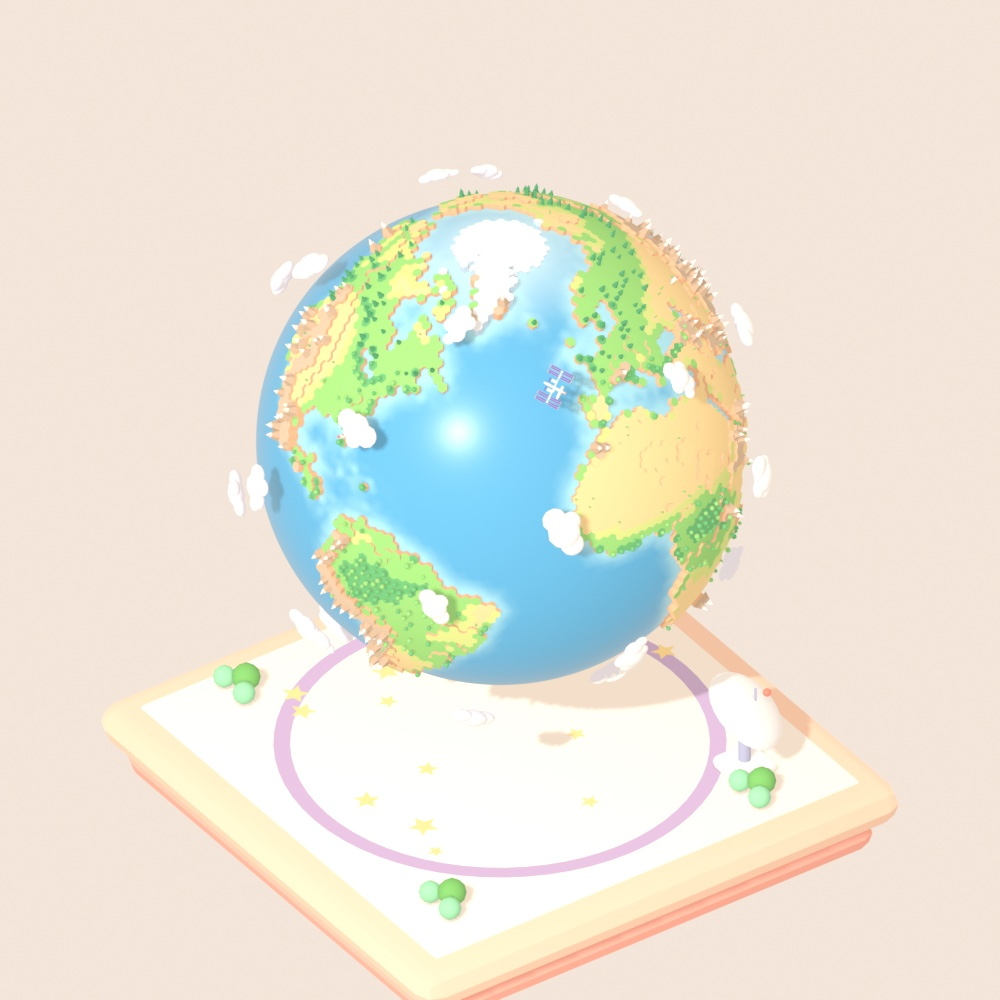
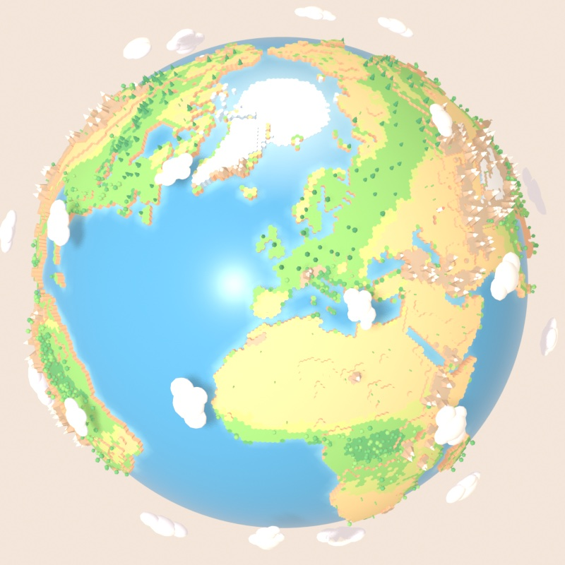
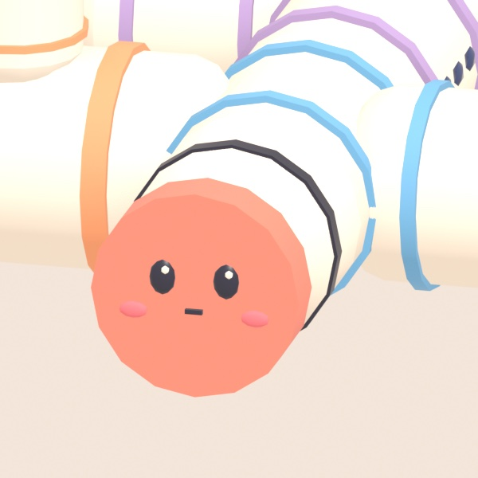

# Blender models

[`iss-tracker-models.blend`](iss-tracker-models.blend) is the source of the three 3D models the app loads from `public/models/`: `earth.glb`, `iss.glb` and `stand.glb`. They were made in Blender by Claude, driving Blender through the Blender MCP server.

The generator scripts are embedded in the `.blend` as text blocks, so the models can be rebuilt and re-exported from any clone of the repository without anything else to install except Blender.

## What is in the file

**Collections and objects**

| Collection   | Root object | Children                                                                                         |
| ------------ | ----------- | ------------------------------------------------------------------------------------------------ |
| `EarthModel` | `Earth`     | `Ocean`, `Land`, `Decor` (trees, cacti, snow-capped mountains and the odd rocket) and `Clouds`                                    |
| `ISSModel`   | `ISS`       | `Truss`, `Modules`, `ServiceArrays`, eight `SolarWing_*` panels, `Beacon` and `Face`             |
| `StandModel` | `Stand`     | `StandBase`                                                                                      |
| `Showcase`   |             | `ISS_Showcase` and `Stand_Showcase`: collection instances used to lay out the preview renders      |
| `Preview`    |             | `PreviewCam` and `PreviewSun`: a camera and a Sun lamp for the renders                           |

**Text blocks** (open them in the Text Editor of the Scripting workspace)

| Text block           | Purpose                                                                                       |
| -------------------- | --------------------------------------------------------------------------------------------- |
| `iss_build_all.py`   | The entry point: rebuilds all three models and exports the GLBs.                              |
| `iss_helpers.py`     | Shared helpers: paths, image sampling, latitude and longitude conversion, materials, objects. |
| `iss_build_earth.py` | Builds the hex-tile Earth from the land, terrain and day-colour maps.                         |
| `iss_land.py`        | Land tiles, heights, biome materials and cliffs.                                              |
| `iss_decor.py`       | The trees, cacti, mountains and rockets scattered on the land.                                |
| `iss_build_iss.py`   | Builds the pastel ISS.                                                                        |
| `iss_iss.py`         | The geometry builder used by the ISS and the stand.                                           |
| `iss_build_stand.py` | Builds the pastel stand.                                                                      |
| `iss_export.py`      | Exports a model to a meshopt-compressed GLB.                                                  |

## Conventions the app relies on

Keep these when you change a model, because the app code and the models share them:

- **Frame.** The glTF exporter turns Blender's Z-up into Y-up. After export, `+Y` is the north pole, `+X` is latitude 0 and longitude 0, and `-Z` is latitude 0 and longitude 90 degrees east. The Earth has radius 1 (the ocean surface).
- **ISS.** The truss runs along `+X` and is normalised to a span of exactly 1.0. In the exported file `+Z` is the direction of flight and `+Y` points away from the Earth. The eight `SolarWing_*` nodes have their origins on the truss, because the app rotates them about their local X axis to face the Sun. `Beacon` is the emissive node the app blinks.
- **Stand.** The origin is the top centre of the stand.
- **Materials.** Flat pastel colours with no textures and no UV coordinates, so the GLBs stay small.
- **Names.** The app looks nodes up by name (`Earth`, `Clouds`, `SolarWing_*`, `Beacon`), so renaming them needs a matching change in `src/components/scene/`.

## Rebuild the models

1. From the repository root, run `bun install`. The Earth is shaped from the Earth images that ship with three-globe's examples (`node_modules/three-globe/example/img`: `earth-water.png`, `earth-topology.png` and `earth-day.jpg`), and the scripts find them relative to the `.blend`.
2. Open `assets/blender/iss-tracker-models.blend` in Blender from inside your clone. The scripts resolve every path relative to the `.blend`, so it must stay at `assets/blender/`.
3. Open the **Scripting** workspace, choose the `iss_build_all.py` text block and press **Run Script**. Blender may pause for a minute or two while it builds the 40,962 Earth tiles.
4. The three files are written to `public/models/`. Check the result with `bun run dev`, and run `bun run test` and `bun run build` before committing.

To export somewhere else, change the last line of `iss_build_all.py` to `print(main("/path/to/folder"))`.

Re-exporting is equivalent but not always byte-identical: `earth.glb` comes out the same, while `iss.glb` and `stand.glb` can differ by a few bytes (the order of materials and the compressed streams), so a binary diff after a rebuild is not a sign that something broke.

### Headless

You can rebuild without opening the Blender interface. Save this as `regenerate.py` anywhere:

```python
import sys

import bpy

out_dir = sys.argv[sys.argv.index("--") + 1]
namespace = {"__name__": "iss_build_all"}
exec(bpy.data.texts["iss_build_all.py"].as_string(), namespace)
print(namespace["main"](out_dir))
```

Then run it from the repository root, adjusting the path to your Blender (this is the macOS path):

```bash
/Applications/Blender.app/Contents/MacOS/Blender --background assets/blender/iss-tracker-models.blend \
  --python regenerate.py -- public/models
```

The script never saves the `.blend`, so the file is unchanged. A successful run prints a report with the tile counts and the size of each GLB, for example `earth.glb` at about 1.3 MB.

The export uses the glTF exporter's meshopt option (`EXT_meshopt_compression`), so use a Blender release whose exporter has it. The models were built, and the headless command above was checked, with Blender 5.2.2 LTS.

## Saving the `.blend`

Blender writes a `*.blend1` backup next to the file when you save. It is git-ignored and should not be committed.

## Previews

<p>
  
  
  
</p>

## Credits

The land, terrain and biome masks are sampled from the Earth images distributed with [three-globe](https://github.com/vasturiano/three-globe)'s examples (`earth-water.png`, `earth-topology.png` and `earth-day.jpg`). three-globe is MIT licensed but does not state where those images come from. They are used once, at build time, to decide which tiles are land, how high they are and what they are made of. The images themselves are not included in the models or in this repository.
